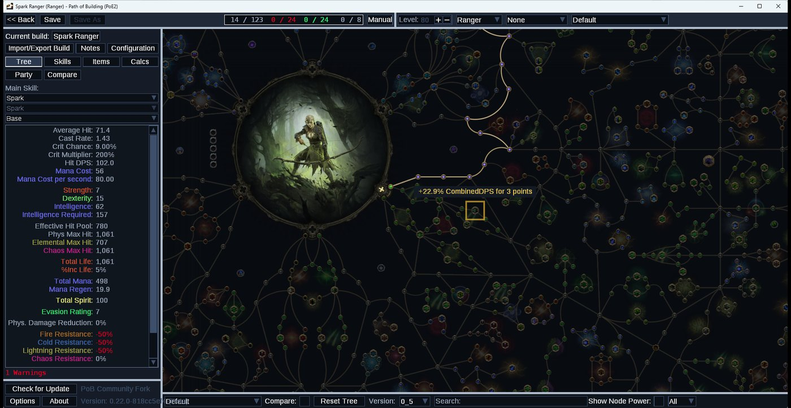
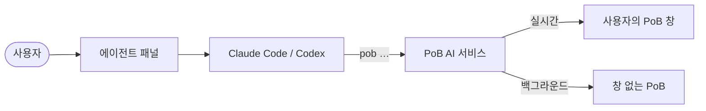

<div align="center">


# PoB AI

**Path of Building (PoE2)를 위한 AI 에이전트와 명령줄 도구.**<br>
평소 말로 물어보세요. 에이전트가 빌드를 읽고, 고치고, 계산하고, PoB 화면에서 정확한 위치를 짚어 줍니다.

[](LICENSE)


[English](README.md) · 한국어

</div>

<p align="center">
  
  
</p>
<p align="center"><sub>왼쪽: <code>pob calc node-power</code>가 5포인트 안에서 가장 효율이 좋은 노드를 찾고, <code>pob ui show-node</code>가 PoB 화면에서 그 노드로 이동해 표시한 모습입니다. 오른쪽: 에이전트 패널입니다.</sub></p>

---

## 왜 만들었나

Path of Building은 PoE2 빌드를 가장 정확하게 계산하는 도구이지만, 어디에 무엇이 있는지 익히는 데
오래 걸립니다. PoB AI는 이 클릭을 AI 에이전트가 대신 하게 해 줍니다. 모든 단계를 명령줄 도구로
실행하기 때문에, 화면에서 확인하고 되돌리고 저장할 수 있는 실제 PoB 작업이 됩니다.

- **PoB를 고치지 않습니다.** 이미 설치한 PoB를 외부 진입 스크립트로 실행합니다. PoB 파일을 하나도
  바꾸지 않으므로 PoB는 평소처럼 스스로 업데이트하고, 수정된 사본을 따로 받을 필요가 없습니다.
- **편집기 전체를 명령으로.** 빌드, 캐릭터, 패시브 트리, 스킬·젬, 아이템, 설정, 계산, 메모를
  90개가 넘는 명령으로 다룹니다.
- **위치를 직접 보여 줍니다.** "적 종류는 어디서 바꿔?"라고 물으면 에이전트가 PoB를 설정 탭으로
  바꾸고 해당 항목을 강조합니다. 패시브 노드, 아이템 슬롯, 젬 그룹, 스탯도 같은 방식입니다.
- **실제 계산값만.** 가정 계산, 패시브 노드 효율 순위, 빌드 비교 모두 PoB 자체 계산기를 씁니다.
- **게임 문구를 내 언어로.** 게임에서 복사한 아이템을 10개 언어 그대로 붙여 넣으면 PoB가 읽는
  영어 문구로 바꿉니다. 바꾸지 못한 줄은 몰래 버리지 않고 알려 줍니다.
- **이미 쓰는 에이전트를 그대로.** Claude Code(또는 Codex)를 기존 로그인으로 실행합니다. API 키가
  필요 없습니다.

## 시작하기

**필요한 것:** Windows 10/11, [Node.js 22 이상](https://nodejs.org),
[Path of Building Community (PoE2)](https://github.com/PathOfBuildingCommunity/PathOfBuilding-PoE2/releases),
그리고 대화 기능을 쓰려면 로그인된 [Claude Code](https://docs.claude.com/en/docs/claude-code).

```bash
git clone https://github.com/<you>/pob-ai.git
cd pob-ai
npm install
```

그다음 **`PoB AI.cmd`**를 더블클릭하면 PoB와 에이전트 패널이 열립니다.

PoB AI는 보통의 설치 위치에서 PoB를 찾습니다. 휴대용(포터블) PoB라면 한 번만 알려 주세요.

```bash
node bin/pob.mjs setup "D:\Games\Path of Building PoE2"
```

아무 터미널에서나 `pob`을 쓰려면 `npm link`를 한 번 실행하세요.

## 이렇게 물어보세요

> 피나클 보스 기준으로 피해를 제대로 측정하도록 PoB를 세팅해 줘.

> 6포인트 안에서 피해를 가장 많이 올려 주는 패시브가 뭐야? 어디 있는지 보여 줘.

> https://pobb.in/… 가져와서 내 빌드랑 비교해 줘.

> 이 아이템 넣고 뭐가 달라지는지 알려 줘 — *(게임에서 복사한 아이템 붙여 넣기)*

에이전트는 질문한 언어로, 게임 공식 용어를 써서 답합니다.

## `pob` 명령줄

모든 명령은 JSON을 출력하므로 에이전트와 스크립트가 바로 쓸 수 있습니다.

```bash
pob build import https://pobb.in/abc123          # 빌드 코드 또는 링크: pobb.in, poe.ninja, Maxroll, poe2db, pastebin
pob tree allocate "Essence of the Storm" --attribute int
pob skills add Spark "Controlled Destruction" --level 20
pob config set enemyIsBoss Pinnacle
pob calc whatif --node "Clean Shot"              # 바꾸지 않고 수치만 확인
pob calc node-power --limit 5                    # 가까운 노드를 Full DPS 상승폭 순으로
pob items add --text "<게임에서 복사한 아이템>" --equip "Ring 1"
pob ui show-config enemyIsBoss                   # PoB 창에서 강조
pob build save --name "Spark Ranger v2"
```

| 그룹 | 다루는 것 |
| --- | --- |
| `build` | 새로 만들기, 열기, 목록, 가져오기, 내보내기, 저장·다른 이름으로 저장, 이름 바꾸기 |
| `character` | 레벨, 클래스, 전직 |
| `tree` | 검색, 할당(무기 세트·능력치 선택 포함), 해제, 초기화, 트리 세트, 버전 변환 |
| `skills` · `gems` | 그룹, 젬, 레벨, 퀄리티, 주력 스킬, 스킬 단계, 소환수, 스킬 세트 |
| `items` | 게임 문구로 추가, 고유 아이템, 커스텀 제작, 장착, 플라스크·부적, 무기 교체, 아이템 세트 |
| `config` | 모든 설정 항목, 설정 세트 |
| `calc` | 스탯, 스킬별 DPS, 경고, 가정 계산, 노드 효율, 빌드 비교 |
| `notes` | 빌드 메모 읽기·쓰기 |
| `ui` | PoB 창의 탭 이동, 노드·슬롯·젬·설정·스탯 강조, 창 테마 |

전체 목록은 **[docs/COMMANDS.md](docs/COMMANDS.md)**에 있습니다. 터미널에서는 `pob help <그룹> <동작>`으로 같은 내용을 볼 수 있습니다.

PoB 창이 열려 있으면 명령이 화면에 바로 반영됩니다. 창이 없으면 빌드의 백그라운드 사본에서
작업하므로, 에이전트가 화면을 건드리지 않고 아이디어를 시험할 수 있습니다.

## 동작 방식



PoB 실행 파일은 첫 번째 인자로 진입 스크립트를 받습니다. PoB AI는 `adapter/shim.lua`로 PoB를
실행합니다. 이 스크립트는 PoB를 평소대로 불러온 뒤, 프레임 사이에 명령을 실행하고 강조 표시를
그리는 작은 브리지를 더합니다. 같은 Lua 명령은 창 없이 PoB의 LuaJIT 안에서도 실행되어
백그라운드 작업에 쓰입니다. 자세한 내용은 [docs/ARCHITECTURE.md](docs/ARCHITECTURE.md)에 있습니다.

**MCP**도 지원합니다. 어떤 MCP 클라이언트든 서비스의 `/mcp` 엔드포인트에서 같은 명령을 도구로 쓸 수 있습니다.

## 언어와 테마

- 패널은 English, 한국어, 日本語, 繁體中文, Русский, Deutsch, Français, Español,
  Português (Brasil), ไทย로 쓸 수 있습니다.
- 이 언어들로 게임에서 복사한 아이템 문구를 PoB용으로 바꿉니다.
- 패널 테마는 네 가지입니다. PoB 창은 `pob ui theme ember|vaal|midnight`로 색을 바꿀 수 있고,
  다음 실행에도 유지됩니다(`default`로 원래 색 복원).

PoB 편집기 자체의 글자는 영어로 남습니다. PoB의 비트맵 글꼴에 ASCII 문자만 있기 때문입니다.

## 개인정보

모든 것이 내 PC에서 실행됩니다. 인터넷 연결은 두 경우뿐입니다. 가져오기를 요청한 빌드를 받을 때,
그리고 한국어 아이템 문구를 변환하려고 Grinding Gear Games·카카오의 공식 거래소 스탯 목록을 받을
때입니다(하루 동안 캐시). 대화 내용은 선택한 에이전트로 전달되며, 그 에이전트의 약관이 적용됩니다.

## 현재 상태

초기 미리보기입니다. 명령, PoB 창 브리지, 백그라운드 엔진은 Windows 11에서 PoB PoE2 0.22.0과
0.23.1로 검증했습니다. 에이전트 대화는 Claude Code와 Codex용으로 구현했고 대체 에이전트로 끝까지
시험했습니다. 실제 Claude Code·Codex 세션으로 끝까지 실행하는 검증은 아직 남아 있습니다.
아직 자동화하지 않은 것은 PoE 계정 캐릭터 가져오기(PoB 가져오기 탭을 쓰세요. `pob ui tab import`가
그 화면으로 안내합니다), 거래소 검색, 시간의 보석 검색입니다.

```bash
npm test     # 단위 시험과, 설치된 PoB로 돌리는 엔진 시험(PoB를 못 찾으면 POB_PATH 지정)
```

## 라이선스

Path of Building과 같은 [MIT](LICENSE)입니다. PoB AI에는 Path of Building이나 게임 데이터가 들어
있지 않습니다. [THIRD_PARTY_NOTICES.md](THIRD_PARTY_NOTICES.md)를 참고하세요.

PoB AI는 비공식 커뮤니티 프로젝트이며, Grinding Gear Games나 Path of Building Community와 관계가
없습니다. Path of Exile은 Grinding Gear Games의 상표입니다.
