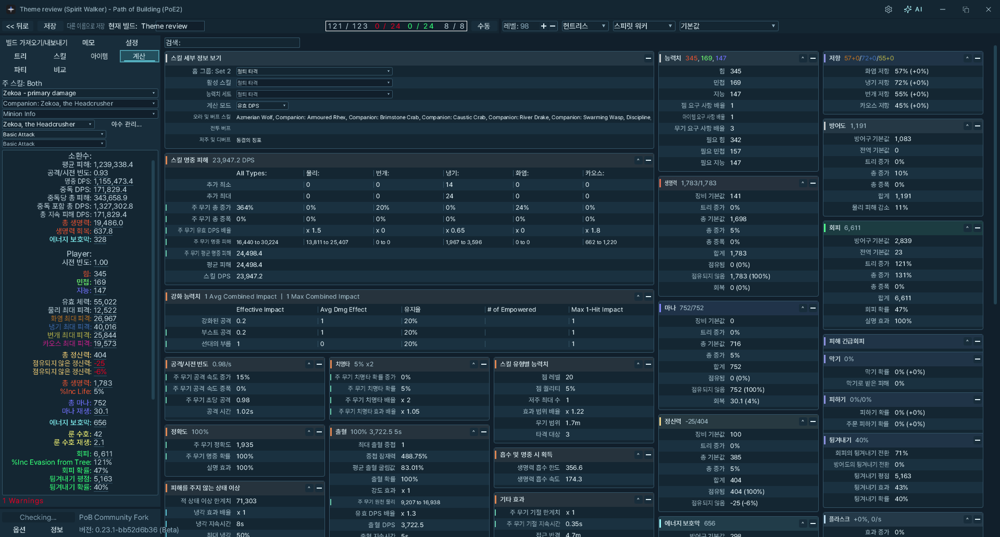
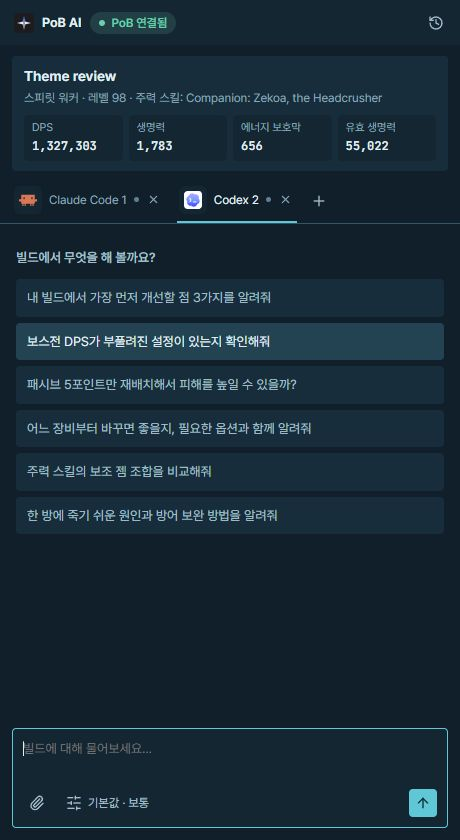
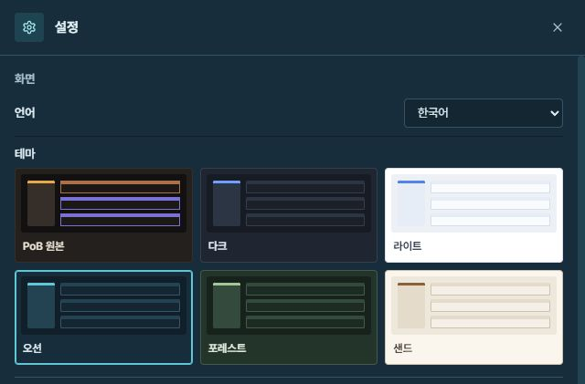
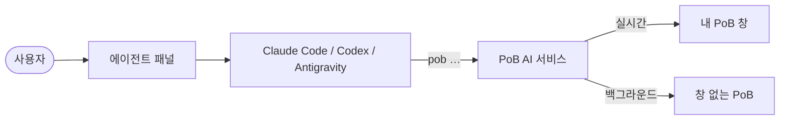

<div align="center">


# PoB AI

**Path of Building (PoE2)를 위한 AI 에이전트와 명령줄 도구.**<br>
평소 말로 물어보세요. 에이전트가 빌드를 읽고, 고치고, 계산하고, PoB 화면에서 정확한 위치를 짚어 줍니다.

[](LICENSE)


[English](README.md) · 한국어

</div>

<p align="center">
  
  
</p>
<p align="center"><sub>오션 테마를 적용한 PoB와 별도 AI Agent 패널입니다. 대화 탭·모델 선택·이미지 첨부는 에이전트 패널에서, 일반 설정은 별도 창에서 사용합니다.</sub></p>

---

## 왜 만들었나

Path of Building은 PoE2 빌드를 가장 정확하게 계산하는 도구이지만, 어디에 무엇이 있는지 익히는 데
오래 걸립니다. PoB AI는 이 클릭을 AI 에이전트가 대신 하게 해 줍니다. 모든 단계를 명령줄 도구로
실행하기 때문에, 화면에서 확인하고 되돌리고 저장할 수 있는 실제 PoB 작업이 됩니다.

- **한 번만 받으면 됩니다.** 이미 설치한 PoB에 PoB 파일을 하나도 바꾸지 않고 붙습니다. PoB는 평소처럼
  스스로 업데이트하고 PoB AI는 그대로 따라갑니다. PoB AI 자체 업데이트도 클릭 한 번이면 됩니다.
- **편집기 전체를 명령으로.** 빌드와 폴더, 로드아웃, 캐릭터 가져오기, 패시브 트리, 스킬·젬, 아이템
  (제작, 기름 부여, 룬, 타락), 거래소 검색, 설정, 계산, 파티, 메모, PoB 옵션까지 142개 명령으로 다룹니다.
- **위치를 직접 보여 줍니다.** "적 종류는 어디서 바꿔?"라고 물으면 에이전트가 PoB를 설정 탭으로
  바꾸고 해당 항목을 강조합니다. 패시브 노드, 아이템 슬롯, 젬 그룹, 스탯도 같은 방식입니다.
- **실제 계산값만.** 가정 계산, 패시브 노드 효율 순위, 빌드 비교 모두 PoB 자체 계산기를 씁니다.
- **어디서나 내 언어로.** PoB 창, 패널, 에이전트 답변을 10개 언어와 게임 공식 용어로 보여 줍니다.
  게임에서 복사한 아이템은 어느 클라이언트 언어든 PoB가 읽는 영어 문구로 바꿉니다.
- **두 창에 같은 테마를.** PoB 원본·다크·라이트·오션·포레스트·샌드 중 한 번만 고르면 패널과 PoB 창에
  함께 적용합니다. 초기 기본값은 PoB 원본입니다. 다른 테마는 Pretendard, 창 너비에 맞는 계산 표,
  테마에 맞춘 툴팁을 사용하며 기존 분류색을 유지합니다.
- **AI와 설정을 따로.** PoB AI 상단바는 항상 표시됩니다. **AI** 버튼은 에이전트 패널을 열거나 앞으로 가져옵니다.
  **톱니 버튼**은 화면·언어·PoB·에이전트 구성을 위한 별도 설정 모달을 엽니다.
- **이미 쓰는 에이전트를 그대로.** Claude Code·Codex·Antigravity를 기존 로그인으로 실행합니다. 카드에서 고르고, 여러
  탭에서 동시에 대화하고, 모델과 추론 강도를 정하고, 스크린샷을 첨부할 수 있습니다. API 키가 필요 없습니다.

<p align="center">
  
</p>
<p align="center"><sub>테마는 한 곳에서 골라 두 창에 함께 적용합니다. 패널과 PoB 창의 기본 언어는 Windows 표시 언어를 따르며, 직접 선택할 수도 있습니다.</sub></p>

## 설치

**필요한 것:** Windows 10/11, 그리고 대화 기능을 쓰려면 로그인된
[Claude Code](https://docs.claude.com/en/docs/claude-code), Codex 0.50.0 이상 또는
[Antigravity](https://antigravity.google/docs/getting-started/?tab=cli) 1.4.4 이상 CLI.
Antigravity는 IDE와 별도로 설치하는 공식 `agy` CLI를 사용합니다. PATH 또는
`%LOCALAPPDATA%\agy\bin`에서 자동 감지하며, 설정에서 실행 파일을 직접 선택할 수도 있습니다.

1. **[Releases](https://github.com/tjdcks12/pob-ai/releases)**에서 `pob-ai-<버전>-win-x64.zip`을 받아 아무 곳에나 압축을 풉니다. Node.js가 들어 있습니다.
2. **`PoB AI.exe`**를 더블클릭하면 콘솔 창 없이 PoB와 에이전트 패널이 열립니다. `PoB AI.cmd`는 호환용으로 유지합니다.

PoB가 없어도 에이전트 패널은 열리며, 첫 화면에 **PoB 설치**와 **기존 PoB 연결**을 표시합니다.
설치는 공식 포터블 PoB를 다운로드한 뒤 자동으로 실행합니다. 기존 PoB 연결은 별도 설정창에서
폴더를 지정하는 방식이므로, PoB 창이 없어도 사용할 수 있습니다. PoB를 찾기 전에는 채팅 입력창과 추천 질문을 숨깁니다.

대화 실패 시 로그인 만료·구버전 CLI·네트워크·사용량 제한·모델·CLI 설정 문제에 맞는 원인과
다음 조치를 표시합니다. **진단정보**에서 감지된 CLI 버전·종료 코드·민감정보를 가린 오류 내용을
확인하고, **진단정보 복사**로 문의에 필요한 보고서를 복사할 수 있습니다.
Codex가 오래된 경우 PowerShell에서 `npm install -g @openai/codex`를 실행한 뒤 다시 시도하세요.
Antigravity는 `agy update`로 업데이트합니다.
로그인이 만료됐다면 오류 메시지의 **로그인** 버튼을 이용하세요.

PoB AI는 보통의 설치 위치에서 [Path of Building Community (PoE2)](https://github.com/PathOfBuildingCommunity/PathOfBuilding-PoE2/releases)를
찾습니다. 휴대용(포터블) PoB라면 한 번만 알려 주거나, PoB 설치를 맡기세요.

```bash
pob setup "D:\Games\Path of Building PoE2"   # 이 PoB를 사용
pob setup --install-pob                      # PoB GitHub 릴리스에서 최신 포터블 PoB를 받아 설치
```

명령줄 도구는 `bin\pob.cmd`입니다. `bin` 폴더를 `PATH`에 추가하면 어디서나 `pob`을 쓸 수 있습니다.

<details>
<summary>소스에서 실행하기</summary>

```bash
git clone https://github.com/tjdcks12/pob-ai.git
cd pob-ai
npm install          # Node.js 22 이상
npm start            # 서비스, PoB 창, 패널
node bin/pob.mjs help
```

`npm link`를 한 번 실행하면 `pob`이 `PATH`에 들어갑니다.
</details>

## 이렇게 물어보세요

에이전트 선택 화면의 **Claude로 로그인**, **ChatGPT로 로그인** 또는 **Google로 로그인**으로 설치된 CLI의 공식 인증을
시작합니다. 이 버튼은 CLI가 미로그인 상태라고 확인했을 때만 표시하며, 로그인된 에이전트에는 표시하지 않습니다. 브라우저에서 로그인하며 진행 안내와 취소는 패널 안에서 처리하고 터미널은 띄우지 않습니다. **계정 만들기**는 해당 서비스의 공식 사이트를 열고, CLI가 없으면 설치 안내를 제공합니다.
Antigravity의 브라우저에 인증 코드가 표시되면 패널의 **인증 코드** 입력란에 붙여넣고 **로그인 완료**를
누르세요. 코드는 대기 중인 CLI에만 전달하며 대화 기록이나 로그에 저장하지 않습니다.
설치 후 패널로 돌아오면 다시 감지합니다.

대화 탭 옆의 **+**로 Claude Code·Codex·Antigravity 대화를 추가합니다. 탭마다 입력 초안과 첨부 이미지를
유지합니다. 입력창 옆에서 모델과 추론 강도를 고르고, **대화 기록**에서 이전 대화를 이어갈 수 있습니다.

새 대화를 만들 때 **전체 권한 허용**을 체크하면 해당 대화에서 파일 수정과 명령 실행을 추가 승인 없이
허용합니다. 새 대화마다 기본값은 꺼짐입니다. 시작 후에는 입력창의 모델·추론 강도 메뉴에서 변경할 수 있으며,
다음 메시지부터 적용됩니다. 세 에이전트 모두 지원합니다. 전체 권한이 꺼져 있으면 Antigravity의
Auto 모드와 자체 샌드박스를 사용합니다. Auto 모드를 지원하지 않는 계정에서 필요한 명령이
거절되면 기존 권한 메뉴로 안내하며, 전체 권한을 자동으로 켜지 않습니다. 모델과 추론 강도 목록은
`agy models`에서 읽고, 첨부 이미지는 Antigravity의 파일 읽기 도구로 전달합니다.

> 내 빌드에서 가장 먼저 개선할 점 3가지를 알려줘.

> 보스전 DPS가 부풀려진 설정이 있는지 확인해줘.

> 패시브 5포인트만 재배치해서 피해를 높일 수 있을까?

> 어느 장비부터 바꾸면 좋을지, 필요한 옵션과 함께 알려줘.

> 주력 스킬의 보조 젬 조합을 비교해줘.

> 한 방에 죽기 쉬운 원인과 방어 보완 방법을 알려줘.

에이전트는 질문한 언어로, 게임 공식 용어를 써서 답합니다.

## `pob` 명령줄

모든 명령은 JSON을 출력하므로 에이전트와 스크립트가 바로 쓸 수 있습니다.

```bash
pob build import https://pobb.in/abc123          # 코드나 링크: pobb.in, poe.ninja, Maxroll, poe2db, pastebin
pob tree allocate "Essence of the Storm" --attribute int
pob tree allocate 태풍의 정수                      # 게임 이름은 10개 언어 어느 것으로 써도 됩니다
pob skills add Spark "Controlled Destruction" --level 20
pob config set enemyIsBoss Pinnacle
pob calc whatif --node "Clean Shot"              # 변경을 남기지 않고 수치만 확인
pob calc node-power --limit 5                    # Full DPS 기준 가까운 특화 노드 순위
pob items add --text "<게임에서 복사한 아이템>" --equip "Ring 1"
pob items trade "Ring 1" --min-percent 90        # 이 아이템과 비슷한 매물의 거래소 검색 링크
pob ui show-config enemyIsBoss                   # PoB 창에서 해당 항목 강조
pob build save --name "Spark Ranger v2"
```

| 그룹 | 다루는 기능 |
| --- | --- |
| `build` | 새로 만들기, 열기, 목록, 가져오기, 내보내기, 저장 / 다른 이름으로 저장, 공유, 이름 바꾸기, 삭제, 이동, 폴더, 로드아웃, 실행 취소 / 다시 실행, 망령·동료 라이브러리 |
| `account` · `character` | PoE 계정 로그인과 캐릭터 가져오기(PoB 경유), 레벨, 직업, 전직 |
| `tree` | 검색, 찍기(무기 세트·능력치 선택), 해제, 초기화, 트리 세트, 트리 링크, 노드 메모, 버전 변환 |
| `skills` · `gems` | 그룹, 젬, 레벨, 퀄리티, 주력 스킬, 스킬 단계, 소환수, 스킬 세트 |
| `items` | 게임 문구로 추가, 고유 아이템, 직접 제작, 편집, 옵션, 기름 부여, 룬, 타락, 장착, 플라스크·호신부, 무기 교체, 아이템 세트, 거래소 검색 |
| `config` · `calc` | 모든 설정 항목과 세트, 스탯, 스킬별 DPS, 경고, 가정 계산, 노드 효율, 빌드 비교, 계산 탭 옵션 |
| `party` · `notes` · `options` | 파티원 버프·저주, 빌드 메모, PoB 자체 설정 |
| `ui` | 탭 전환, 노드·슬롯·젬·설정·스탯 강조, 트리 검색과 히트맵, 거래소 검색 / 비슷한 매물, 창 언어와 테마 |
| `setup` · `update` · `doctor` | PoB 찾기·설치, PoB AI 업데이트, 전체 점검 |

전체 목록: **[docs/COMMANDS.md](docs/COMMANDS.md)**. 터미널에서 `pob help <그룹> <동작>`으로도 볼 수 있습니다.

PoB 창이 열려 있으면 명령이 그 화면을 바로 바꿉니다. 창이 없으면 빌드의 백그라운드 사본에서
동작하므로, 에이전트가 화면을 건드리지 않고 아이디어를 시험할 수 있습니다.
PoB의 *Find Timeless Jewel*(영겁의 보석 찾기)은 PoB PoE2 자체에서 꺼져 있어 아직 명령이 없습니다.

## 내 언어로

설정에서 언어를 한 번 선택하면 패널과 PoB 창에 함께 적용합니다. 기본값은 Windows 표시 언어를 따르며, **시스템 설정 따름**(`pob ui language system`도 가능)을 선택하면 다시 Windows 언어를 따릅니다. 지원하지 않는 시스템 언어는 영어로 표시합니다.

| | |
| --- | --- |
| **PoB 창** | `pob ui language ko`(또는 설정 모달): English, 한국어, 日本語, 繁體中文, Русский, Deutsch, Français, Español, Português (Brasil), ไทย. 게임 이름은 게임 클라이언트의 공식 용어를, PoB 화면 문구 약 2,000개는 PoB AI의 번역을 씁니다. |
| **에이전트와 명령** | 질문한 언어로 답하고, 게임 이름을 그 언어로 받고 돌려줍니다(`--lang`). |
| **아이템** | 10개 언어 게임 클라이언트에서 복사한 문구를 PoB용으로 바꿉니다. 바꾸지 못한 줄은 몰래 버리지 않고 알려 줍니다. |
| **테마** | PoB 원본·다크·라이트·오션·포레스트·샌드(`pob ui theme pob\|dark\|light\|ocean\|forest\|sand`). 설정에서 한 번 선택하면 패널과 PoB 창에 함께 적용하며, PoB가 꺼져 있으면 다음 실행 때 적용합니다. 새 설치 기본값은 PoB 원본입니다. 다른 테마는 Pretendard와 창 너비에 맞는 계산 표를 사용하고 기존 분류색을 유지합니다. |
| **패널 창** | 별도 Edge WebView2 창에서 poe2way 로고, 드래그 가능한 상단 메뉴, 최소화·최대화·닫기 버튼을 한 줄에 표시합니다. Windows의 Evergreen WebView2 Runtime을 사용하며, 사용할 수 없으면 기존 Edge 앱 창으로 엽니다. 소스 실행 시 첫 실행에서 창 셸을 빌드하거나 `npm run build:panel`로 미리 빌드할 수 있습니다. |

PoB의 비트맵 글꼴에는 ASCII 글자만 있어서, PoB AI가 Pretendard(태국어·일본어·중국어는 Windows 글꼴)로
만든 글리프 아틀라스에서 PoB와 똑같은 위치에 글자를 그립니다. 영어보다 긴 번역은 그 자리에 맞게 좁혀
그립니다. 번역이 없는 문구는 영어로 남습니다.

## 업데이트

- **PoB**는 평소처럼 스스로 업데이트합니다. PoB AI는 설치된 버전에 그대로 붙고, PoB가 업데이트로
  다시 시작해도 자동으로 다시 연결됩니다.
- **PoB AI**는 하루 한 번 새 버전을 확인해 **설정 창**에서 알려 줍니다. **업데이트**를 누르거나
  `pob update apply --restart`를 실행하세요. 받은 파일은 SHA-256으로 검증한 뒤 데이터 폴더에 풀고,
  다음 시작부터 사용합니다. PoB 창은 열린 채로 다시 연결됩니다.

문제가 있으면 `pob doctor`가 PoB 설치, 현재 PoB 버전과의 호환성, 창 연결, 업데이트, 에이전트를 점검하고
해결 방법을 알려 줍니다. 로그는 `%LOCALAPPDATA%\pob-ai\logs`에 있습니다.

## 동작 방식



PoB 실행 파일은 첫 번째 인자로 진입 스크립트를 받습니다. PoB AI는 `adapter/shim.lua`로 PoB를
실행합니다. 이 스크립트는 PoB를 평소대로 불러오고, 프레임 사이에 명령을 실행하며 강조·테마·번역
문구를 그리는 작은 브리지를 더합니다. 같은 Lua 작업이 창 없이 PoB의 LuaJIT 안에서도 돌아가
백그라운드 작업을 처리합니다.
자세한 내용: [docs/ARCHITECTURE.md](docs/ARCHITECTURE.md) · [docs/POB_INTERNALS.md](docs/POB_INTERNALS.md).

**MCP**도 지원합니다. MCP 클라이언트는 서비스의 `/mcp` 주소에서 같은 명령을 도구(`pob_<그룹>_<동작>`)로 쓸 수
있습니다. 주소와 토큰은 `%LOCALAPPDATA%\pob-ai\service.json`에 있고, `Authorization: Bearer <토큰>`으로 보냅니다.

## 개인정보

모든 작업은 내 PC에서 실행됩니다. PoB AI가 인터넷에 접속하는 경우는 다음뿐입니다.

- 가져오라고 한 빌드를 받거나, 공유하라고 한 빌드를 올릴 때
- 한국어 아이템 문구를 바꾸려고 Grinding Gear Games / 카카오의 공식 거래소 스탯 목록을 받을 때(하루 동안 캐시)
- 하루 한 번 업데이트를 확인할 때, 그리고 요청한 업데이트나 PoB를 받을 때
- PoB 자체가 하는 온라인 작업(계정 가져오기, 거래소, PoB 자체 업데이트 확인)

대화 내용은 선택한 에이전트로 전달되며 그 서비스의 약관을 따릅니다.

## 현재 상태

이 문서는 Antigravity 연동과 인증 코드 로그인 흐름을 포함한 v0.2.4 기준입니다.
배포 ZIP은 [GitHub 릴리스](https://github.com/tjdcks12/pob-ai/releases/latest)에서 받을 수 있습니다.
Windows 11, PoB PoE2 0.22.0과 0.23.1에서 호환성을 확인했습니다. 현재 **165개 테스트가 통과**하며,
편집 명령, 에이전트 세션과 권한, 언어 선택, 공통 테마 저장, 팝업 표시, 업데이트 등을 검사합니다.

실제 PoB와 WebView2 창에서 6개 테마, 전환 전후 계산값 유지, AI·설정 창 분리, 입력 초안 유지,
작은 창 배치를 확인했습니다. 실제 PoE 계정 캐릭터 가져오기, Windows 10, 다중 모니터,
Windows 화면 배율은 추가 수동 확인이 필요합니다.
Antigravity 1.4.7은 로컬 응답 서버를 통해 실제 이미지·명령 도구, 모델·추론 강도 선택과 대화 이어가기를
검사했습니다. 실제 Google OAuth 완료와 유료 모델 응답은 아직 확인하지 않았습니다.

## 개발

엔진 테스트는 평소 사용하는 PoB와 분리한 사본 및 임시 데이터 폴더에서 실행합니다.

```powershell
$env:POB_PATH = 'D:\Tests\PoB-PoE2'  # 테스트용 PoB 사본
$env:POB_AI_HOME = Join-Path $env:TEMP ('pob-ai-test-' + [guid]::NewGuid().ToString('N'))
npm test
npm run build:panel               # 네이티브 WebView2 창 셸 빌드
node scripts/package.mjs          # dist/pob-ai-<버전>-win-x64.zip, dist/latest.json
node scripts/gen-commands.mjs     # docs/COMMANDS.md 다시 만들기
```

게임 패치 뒤 함께 담긴 게임 문구는 관리자가 `node scripts/sync-game-data.mjs <poe2way-overlay> <poe2way>`로
갱신합니다. 문구를 뽑아 두는 비공개 데이터 저장소를 읽기 때문에, 다른 기여자는 `data/`를 그대로 쓰면 됩니다.

`v<버전>` 태그를 올리면 릴리스를 만들어 게시합니다(`.github/workflows/release.yml`). 매일 최신 PoB
릴리스로 테스트하는 워크플로도 있습니다.

## 라이선스

Path of Building과 같은 [MIT](LICENSE)입니다. PoB AI에는 Path of Building이 들어 있지 않습니다.
함께 배포하는 구성 요소와 게임 문구는 [THIRD_PARTY_NOTICES.md](THIRD_PARTY_NOTICES.md)를 보세요.

PoB AI는 비공식 커뮤니티 프로젝트이며 Grinding Gear Games나 Path of Building Community와 관련이
없습니다. Path of Exile은 Grinding Gear Games의 상표입니다.
