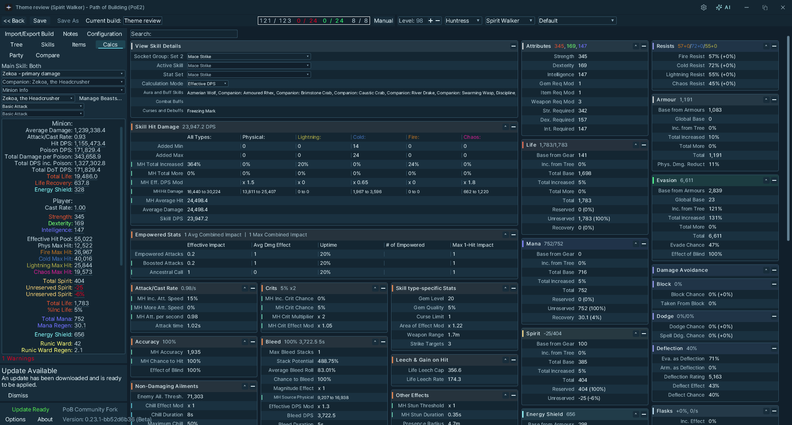
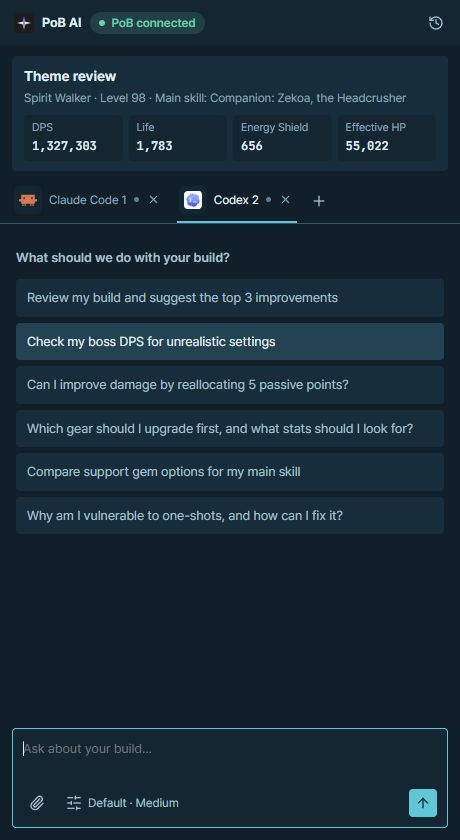
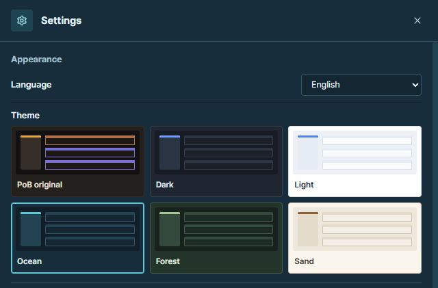
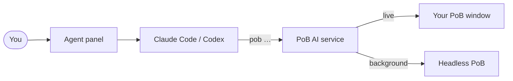

<div align="center">


# PoB AI

**An AI agent and a command line for Path of Building (PoE2).**<br>
Ask in plain words. The agent reads your build, changes it, calculates, and points at the exact spot in PoB.

[](LICENSE)


English · [한국어](README.ko.md)

</div>

<p align="center">
  
  
</p>
<p align="center"><sub>The Ocean theme in PoB and the separate AI Agent panel. Chat tabs, model controls and image attachments stay in the agent panel; general settings have their own window.</sub></p>

---

## Why

Path of Building is the most precise tool for Path of Exile 2 builds, and it takes years to learn
where everything lives. PoB AI lets an AI agent do the clicking for you, through a complete
command line, so every step is real PoB work you can see, undo and save.

- **Download once.** PoB AI attaches to the Path of Building you already have, without changing a
  single PoB file. PoB keeps updating itself and PoB AI follows; PoB AI updates itself with one click.
- **The whole editor from the command line.** 143 commands cover builds and folders, loadouts,
  character import, passive tree, skills and gems, items (crafting, anoints, runes, corruption),
  trade searches, configuration, calculations, party, notes and PoB's own options.
- **It shows you where.** Ask "where do I set the enemy type?" and the agent switches PoB to the
  Configuration tab and highlights the option. Nodes, item slots, gem groups and stats work the same way.
- **Real numbers only.** What-if calculations, passive node ranking and build comparison use PoB's
  own calculator.
- **Your language, everywhere.** The PoB window, the panel and the agent's answers in ten languages,
  with the official in-game names. Items copied from the game in any client language are converted
  to the English text PoB reads.
- **One theme for both windows.** Choose PoB original, Dark, Light, Ocean, Forest or Sand once
  for the panel and PoB together. PoB original is the initial default. Custom themes use Pretendard,
  responsive calculation tables and themed tooltips while keeping PoB's category colours.
- **AI and settings, separately.** The title bar's **AI** button opens or brings the agent panel
  forward. The **gear** opens a separate settings modal for appearance, languages, PoB and agent setup.
- **Uses the agent you already have.** Claude Code or Codex runs with your existing sign-in: pick it
  from the cards, chat in several tabs at once, choose the model and reasoning effort, attach
  screenshots. No API keys.

<p align="center">
  
</p>
<p align="center"><sub>One theme selection applies to both windows. Panel and PoB languages follow the Windows display language by default, with manual overrides available.</sub></p>

## Install

**Requirements:** Windows 10/11 and, for chat, [Claude Code](https://docs.claude.com/en/docs/claude-code)
(or Codex) signed in.

1. Download `pob-ai-<version>-win-x64.zip` from **[Releases](https://github.com/tjdcks12/pob-ai/releases)** and unzip it anywhere. Node.js is included.
2. Double-click **`PoB AI.cmd`**. It opens your PoB and the agent panel.

PoB AI finds [Path of Building Community (PoE2)](https://github.com/PathOfBuildingCommunity/PathOfBuilding-PoE2/releases)
in the usual install locations. Point it at a portable copy once, or let it install PoB for you:

```bash
pob setup "D:\Games\Path of Building PoE2"   # use this PoB
pob setup --install-pob                      # download the latest portable PoB from its GitHub releases
```

`bin\pob.cmd` is the command line; add the `bin` folder to `PATH` to use `pob` anywhere.

<details>
<summary>Run from source</summary>

```bash
git clone https://github.com/tjdcks12/pob-ai.git
cd pob-ai
npm install          # Node.js 22+
npm start            # service, PoB window and panel
node bin/pob.mjs help
```

`npm link` puts `pob` on your `PATH`.
</details>

## Talk to it

Use **+** beside the chat tabs to start another conversation with Claude Code or Codex. Each tab
keeps its own draft and attachments. Choose the model and reasoning effort beside the composer,
or open **History** to resume a previous conversation.

> Review my build and suggest the top 3 improvements.

> Check my boss DPS for unrealistic settings.

> Can I improve damage by reallocating 5 passive points?

> Which gear should I upgrade first, and what stats should I look for?

> Compare support gem options for my main skill.

> Why am I vulnerable to one-shots, and how can I fix it?

The agent answers in your language and uses the official in-game names.

## The `pob` command line

Every command prints JSON, so agents and scripts can use it directly.

```bash
pob build import https://pobb.in/abc123          # code or link: pobb.in, poe.ninja, Maxroll, poe2db, pastebin
pob tree allocate "Essence of the Storm" --attribute int
pob tree allocate 태풍의 정수                      # game names work in any of the ten languages
pob skills add Spark "Controlled Destruction" --level 20
pob config set enemyIsBoss Pinnacle
pob calc whatif --node "Clean Shot"              # numbers without keeping the change
pob calc node-power --limit 5                    # best nearby notables by Full DPS
pob items add --text "<item copied in game>" --equip "Ring 1"
pob items trade "Ring 1" --min-percent 90        # trade search link for items like this one
pob ui show-config enemyIsBoss                   # highlight it in the PoB window
pob build save --name "Spark Ranger v2"
```

| Group | What it covers |
| --- | --- |
| `build` | new, open, list, import, export, save / save as, share, rename, delete, move, folders, loadouts, undo / redo, spectre & companion library |
| `account` · `character` | PoE account sign-in and character import (through PoB), level, class, ascendancy |
| `tree` | search, allocate (weapon sets, attributes), deallocate, reset, tree sets, tree links, node notes, version conversion |
| `skills` · `gems` | groups, gems, levels, quality, main skill, skill parts, minions, skill sets |
| `items` | add from game text, uniques, custom crafts, edit, mods, anoints, runes, corruption, equip, flasks & charms, weapon swap, item sets, trade search |
| `config` · `calc` | every configuration option and set; stats, per-skill DPS, warnings, what-if, node power, build comparison, Calcs tab options |
| `party` · `notes` · `options` | party member buffs and curses, build notes, PoB's own settings |
| `ui` | switch tabs, highlight nodes, slots, gems, options and stats, tree search and heat map, Trade for / Buy similar, window language and theme |
| `setup` · `update` · `doctor` | find or install PoB, update PoB AI, check everything |

Full reference: **[docs/COMMANDS.md](docs/COMMANDS.md)**. `pob help <group> <action>` shows the same in the terminal.

When the PoB window is open, commands change what you see there. Without it, they work on a
background copy of your build, so agents can explore ideas without touching your screen.
PoB's *Find Timeless Jewel* search is switched off in PoB PoE2 itself, so it has no command yet.

## Your language

The panel and PoB window follow the Windows display language by default. Choosing a language in Settings overrides it; choose **System default** (or `pob ui language system` for PoB) to follow Windows again. Unsupported system languages fall back to English.

| | |
| --- | --- |
| **PoB window** | `pob ui language ko` (or the settings modal): English, 한국어, 日本語, 繁體中文, Русский, Deutsch, Français, Español, Português (Brasil), ไทย. Official names from the game client; about 2,000 PoB interface phrases translated by PoB AI. |
| **Agent and commands** | Answers in your language; game names are accepted and returned in it (`--lang`). |
| **Items** | Text copied from the game client in any of the ten languages is converted for PoB. Lines that cannot be converted are reported, never dropped silently. |
| **Themes** | PoB original, Dark, Light, Ocean, Forest and Sand (`pob ui theme pob\|dark\|light\|ocean\|forest\|sand`). One choice in Settings applies to the panel and PoB window together, and is used the next time PoB opens if it is closed. New installations start with PoB original. Custom themes use Pretendard and responsive calculation tables while keeping PoB's category colours. |
| **Panel window** | A separate Edge WebView2 window with the poe2way logo, one draggable header and custom minimize/maximize/close controls. Windows supplies the Evergreen WebView2 Runtime; the normal Edge app is a fallback. Local source checkouts build the small window shell on first launch, or with `npm run build:panel`. |

PoB's bitmap fonts only contain ASCII, so PoB AI draws text from a glyph atlas made with Pretendard
(and Windows fonts for Thai, Japanese and Chinese) at the exact positions PoB would use. A
translation wider than the English is squeezed into its space. Text without a translation stays in English.

## Updates

- **PoB** updates itself as always. PoB AI attaches to whichever version is installed, and after
  PoB restarts for its own update, PoB AI is attached again automatically.
- **PoB AI** checks for a new version once a day and offers it in **Settings**. Click **Update** or run
  `pob update apply --restart`. The update is verified (SHA-256), unpacked into your data folder
  and used from the next start. The PoB window stays open and reconnects.

Something off? `pob doctor` checks the PoB install, the adapter against your PoB version, the
window connection, updates and agents, and says what to do. Logs are in `%LOCALAPPDATA%\pob-ai\logs`.

## How it works



The PoB launcher accepts an entry script as its first argument. PoB AI starts your PoB with
`adapter/shim.lua`, which loads PoB normally and adds a small bridge that runs commands between
frames and draws the highlights, the themes and the translated text. The same Lua operations also
run without a window, inside PoB's own LuaJIT, for background work.
Details: [docs/ARCHITECTURE.md](docs/ARCHITECTURE.md) · [docs/POB_INTERNALS.md](docs/POB_INTERNALS.md).

It also speaks **MCP**: any MCP client can use the same commands as tools (`pob_<group>_<action>`) at the
service's `/mcp` endpoint. The address and token are in `%LOCALAPPDATA%\pob-ai\service.json`; send
`Authorization: Bearer <token>`.

## Privacy

Everything runs on your PC. PoB AI goes online only:

- to download a build you ask it to import, or to upload one you ask it to share;
- for Korean item text, to fetch the official trade stat lists from Grinding Gear Games / Kakao (cached for a day);
- to check its update feed once a day, and to download an update or PoB when you ask;
- through PoB itself, for what PoB does online (account import, trade, PoB's own update check).

Chats go to the agent you chose, under its own terms.

## Status

This README describes the current preview source; release ZIPs follow their own version.
Compatibility has been checked on Windows 11 with PoB PoE2 0.22.0 and 0.23.1. The current suite
has **134 passing tests**, covering editor operations, agent sessions, language selection, shared
theme persistence, popup rendering and updates.

Local PoB and WebView2 checks cover all six themes, unchanged calculation results across theme
switches, separate AI/settings windows, chat drafts, and compact layouts. Real PoE account import,
Windows 10, multiple monitors and Windows display scaling still need manual verification.

## Development

Use a disposable PoB copy and an isolated data folder for engine tests:

```powershell
$env:POB_PATH = 'D:\Tests\PoB-PoE2'  # a copy of PoB, separate from the one you use
$env:POB_AI_HOME = Join-Path $env:TEMP ('pob-ai-test-' + [guid]::NewGuid().ToString('N'))
npm test
npm run build:panel               # build the native WebView2 window shell
node scripts/package.mjs          # dist/pob-ai-<version>-win-x64.zip and dist/latest.json
node scripts/gen-commands.mjs     # regenerate docs/COMMANDS.md
```

Maintainers refresh the bundled game text after a game patch with
`node scripts/sync-game-data.mjs <poe2way-overlay> <poe2way>`; it reads the private data repositories
the text is extracted into. Contributors use `data/` as it is.

Pushing a `v<version>` tag builds and publishes a release (`.github/workflows/release.yml`). A daily
workflow runs the tests against the latest PoB release.

## License

[MIT](LICENSE), like Path of Building. PoB AI does not include Path of Building; see
[THIRD_PARTY_NOTICES.md](THIRD_PARTY_NOTICES.md) for bundled components and game text.

PoB AI is an unofficial community project, not affiliated with Grinding Gear Games or the Path of
Building Community. Path of Exile is a trademark of Grinding Gear Games.
