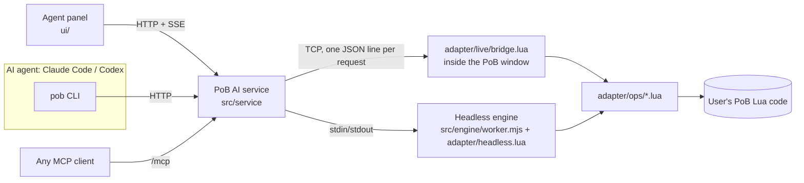

# Architecture

PoB AI drives the Path of Building (PoE2) that the user installed, without changing any of its
files. Three pieces work together:



## The PoB window: shim, not a patch

The PoB launcher (`Path of Building-PoE2.exe`) is a small program that loads the DLL named on
the first line of a Lua script (`#@ SimpleGraphic`) and runs that script. It accepts the script
as its first argument. PoB AI starts

```
"Path of Building-PoE2.exe" "<pob-ai>/adapter/shim.lua"
```

`adapter/shim.lua` points module loading back at the PoB folder (`GetScriptPath`, `LoadModule`,
`PLoadModule`), runs PoB's own `Launch.lua`, and after PoB has initialised loads
`adapter/live/bridge.lua`, which wraps `main.OnFrame`:

1. Before PoB's frame: read at most one request from the service, run it, reply.
2. PoB's own frame (input, recalculation, drawing).
3. After the frame: draw the agent's highlight overlay (`adapter/live/overlay.lua`).

Operations that need PoB to lay out or recalculate (switching tabs, opening a build) wait for a
frame with `util.waitFrame()`; requests run as coroutines so the window never blocks.

Because nothing in the PoB folder is modified, PoB's own update check keeps working and its
updates are never overwritten.

## The headless engine

When the PoB window is not open, commands run in a background process. `src/engine/worker.mjs`
loads PoB's own `lua51.dll` (LuaJIT) through [koffi](https://koffi.dev) and runs
`adapter/headless.lua`, which provides the window functions PoB expects (the same set as PoB's
`HeadlessWrapper.lua`) and blocks file writes except explicit saves. The current headless build
is kept in the data folder (`session/current.xml`) so consecutive CLI calls build on each other.

LuaJIT opens files through the ANSI code page, so a PoB folder with non-ASCII characters
(for example `한글 POB`) is reached through a directory junction in the data folder.

## Operations

`adapter/ops/*.lua` implement every command by calling the same PoB objects the GUI uses,
including undo states and unsaved flags (see [POB_INTERNALS.md](POB_INTERNALS.md)). They run in
both modes. `src/commands/registry.mjs` defines names, arguments and help once; the CLI, the HTTP
API, the MCP server and [COMMANDS.md](COMMANDS.md) are generated from it. A few commands run in
Node first (`local` in the registry): downloads, build files, item text conversion.

## Item text in other languages

PoB reads English item text only. `src/items/` converts game copy text (Ctrl+C) from ten client
languages into the English PoB expects: Korean through the official trade stat lists (cached for a
day), the others through the bundled language packs in `data/items/`. Lines that cannot be
converted are reported back instead of being silently dropped.

## The agent

`src/agent/hub.mjs` runs the agent CLI the user is already signed in to, in non-interactive mode,
once per chat turn, and resumes the same conversation on the next turn. The agent works in a
folder whose `CLAUDE.md` / `AGENTS.md` explain the `pob` command line. Claude Code may only run
`pob …` commands; file editing tools are disabled.

## Data folder

`%LOCALAPPDATA%\pob-ai` (override with `POB_AI_HOME`): settings, the service address, the
headless session build, agent chats, caches and logs. Nothing is written to the PoB folder except
builds the user asks to save.

## Version support

Verified with PoB PoE2 0.22.0 and 0.23.1. `util.new()` hides the constructor style change between
them (`new("X", …)` vs `new("X"):X(…)`). `npm test` runs the engine suite against whatever PoB it
finds (`POB_PATH`), including a check that every registry command has an adapter operation.
